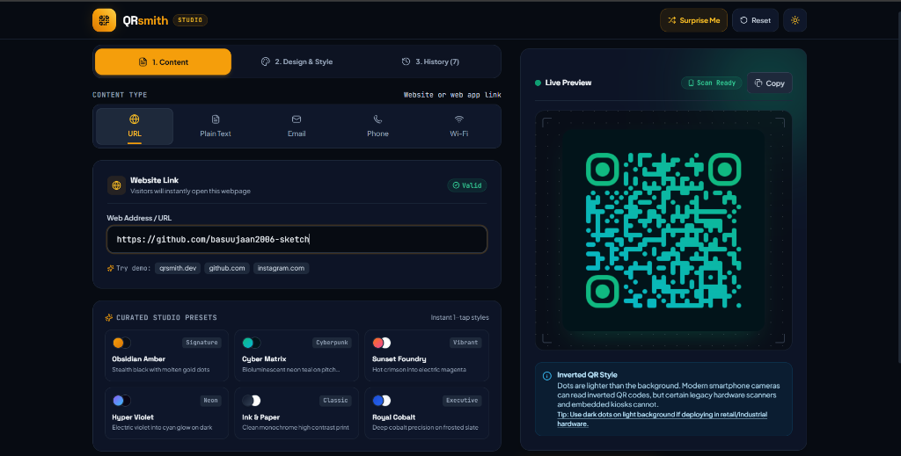
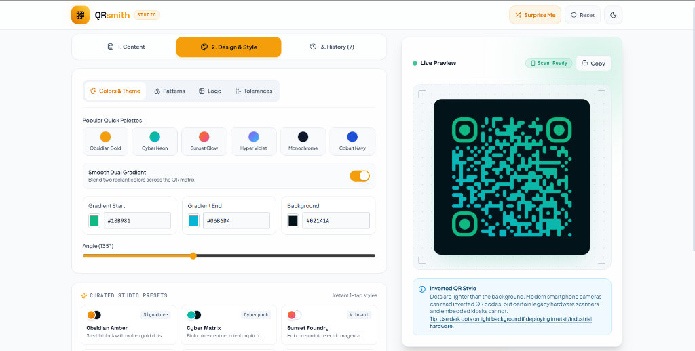

# QRsmith — Precision QR Code Generator & Vector Forge

A high-precision, craftsman-styled QR code generator and customizer that runs 100% in the browser. Zero backend required, zero external data leakage, and instantaneous real-time rendering.

<p align="center">
  
  
</p>

---

## 🛠 Tech Stack

- **Framework**: React 18 + Vite
- **Styling**: Tailwind CSS (custom craftsman tokens, dark & light themes, zero horizontal scroll, fluid responsiveness)
- **QR Generation Engine**: `qr-code-styling` (direct client-side rendering with SVG / Canvas rasterization)
- **Icons**: `lucide-react`
- **Typography**: Space Grotesk (display), Plus Jakarta Sans (interface), JetBrains Mono (data metrics)
- **Persistence**: Browser Native `localStorage` API for recent codes and theme preference

---

## 🚀 Getting Started Locally

### 1. Prerequisites
Ensure you have **Node.js 18+** and **npm** installed on your machine.

### 2. Installation
Clone or navigate to the project directory and install dependencies:

```bash
git clone <repository-url>
cd QRsmith
npm install
```

### 3. Launch Development Server
```bash
npm run dev
```
Open your browser at `http://localhost:5173` (or the URL displayed in your terminal).

### 4. Production Build
```bash
npm run build
npm run preview
```
The optimized production bundle will be generated in `dist/`.

---

## 🌐 Deployment Instructions

### Deploy to Vercel
1. Push your repository to GitHub / GitLab / Bitbucket.
2. Sign in to [Vercel](https://vercel.com) and click **"Add New Project"**.
3. Import your `QRsmith` repository.
4. Vercel automatically detects the Vite configuration:
   - **Framework Preset**: `Vite`
   - **Build Command**: `npm run build`
   - **Output Directory**: `dist`
5. Click **"Deploy"**. Your site will be live on a global CDN in seconds.

### Deploy to Netlify
1. Log in to [Netlify](https://netlify.com) and click **"Add new site"** > **"Import an existing project"**.
2. Select your repository.
3. Configure the build settings:
   - **Build command**: `npm run build`
   - **Publish directory**: `dist`
4. Click **"Deploy QRsmith"**.

---

## 📐 Responsive Breakpoint Compliance

QRsmith is engineered with a strict mobile-first and fluid layout architecture:

| Breakpoint | Dimensions | Layout Strategy |
| :--- | :--- | :--- |
| **Mobile** | `320px – 480px` (iPhone SE, etc.) | Single column. Sticky/top QR preview with real-time feedback while scrolling controls. 44x44px minimum tap targets. |
| **Mobile Large** | `480px – 768px` (Standard phones) | Single column with 2-column input subgrids and horizontal recent strip. |
| **Tablet** | `768px – 1024px` (iPad, tablets) | Balanced dual-column grid or fluid stacked view based on orientation. |
| **Desktop** | `1024px – 1440px` | Two-column layout: Form and styling controls on the left, sticky preview & export on the right. |
| **Large Desktop**| `1440px+` | Centered max-w-7xl canvas with proportional high-resolution preview. |

**Zero Horizontal Overflow**: All containers utilize relative flex/grid units, preventing unwanted horizontal scrollbars across all screen widths and device orientations.

---

## 🎯 Core Features

1. **Real-time Live Preview**: Debounced (~160ms) rendering updates instantly as you type or adjust parameters without UI jank.
2. **5 Content Formats**:
   - **URL**: Web links with automatic protocol normalization.
   - **Plain Text**: Unconstrained text, voucher codes, or notes (up to 2,500 chars).
   - **Email**: Mailto links with pre-filled recipient, subject, and body.
   - **Phone**: Direct-dial `tel:` links formatted for mobile handsets.
   - **Wi-Fi**: Automatic MeCard standard format with SSID, WPA/WEP/None, and hidden network flag.
3. **Deep Customization**:
   - **Data Dot Shapes**: Square, Rounded, Dots, Classy, Classy Rounded, and Extra Rounded.
   - **Corner Eyes**: Custom Corner Square (outer) and Corner Dot (inner) styles.
   - **Dual Colors & Gradients**: Solid color picker or 2-color linear/radial gradients with angle rotation.
   - **Quiet Zone (Margin)**: 0px to 40px adjustable padding.
   - **Export Resolution**: Slider from 200px to 1000px high-DPI rasterization.
   - **Center Logo Embedding**: Upload PNG, SVG, or JPG with customizable scale and clear margin.
4. **Scan Reliability Safeguards**:
   - **Contrast Ratio Analyzer**: Computes WCAG luminance ratio and warns if contrast is below safe threshold (< 3.0:1).
   - **Inverted Detection**: Warns if light dots on dark background may impede legacy laser/CCD barcode scanners.
   - **Logo Redundancy Protection**: Recommends Error Correction Level Q (25%) or H (30%) when embedding a logo.
5. **Craftsman Presets**: 6 pre-configured styles (*Forge Classic*, *Obsidian Amber*, *Sunset Foundry*, *Cyber Emerald*, *Royal Sapphire*, *Minimal Slate*).
6. **Download & Clipboard**:
   - High-resolution PNG export matching the exact selected pixel resolution.
   - Scalable Vector Graphics (SVG) export.
   - One-click copy QR image to clipboard.
7. **Local Persistence**: Automatically stores recent 10 generated codes with thumbnails in browser `localStorage`. Click to restore anytime.
8. **Theme Toggle**: Light / Dark craftsman modes with automatic system preference detection.

---

## 📋 Comprehensive Manual Test Checklist

- [x] **URL Type**: Validates valid web address, handles auto-prefixing `https://`, rejects empty input.
- [x] **Plain Text Type**: Live character counter, multi-line support, max-length validation.
- [x] **Email Type**: Validates email regex, supports optional subject and body parameters.
- [x] **Phone Type**: Validates numeric length (6–16 digits) and optional leading country code `+`.
- [x] **Wi-Fi Type**: Tests WPA, WEP, and open networks. Toggles hidden SSID and password visibility.
- [x] **Dot Styles**: Verifies all 6 dot geometry options render without artifacts.
- [x] **Corner Eye Styles**: Tests outer square and inner dot styling combinations.
- [x] **Gradients**: Linear gradient angle rotation and radial gradient rendering.
- [x] **Logo Embedding**: Uploads custom image, tests logo scale slider, removes logo cleanly.
- [x] **Contrast Safeguard**: Displays inline warning when choosing low contrast foreground/background.
- [x] **Error Correction Safeguard**: Displays advisory when logo is added on Level L or M.
- [x] **PNG Download**: Exports at user-specified resolution (e.g., 800x800px).
- [x] **SVG Download**: Exports vector XML format.
- [x] **Clipboard Copy**: Copies raw PNG blob to system clipboard.
- [x] **Recent History**: Restores saved code on click, persists through page reload, removes items, clears all.
- [x] **Responsive Layout**: Verified across 320px, 480px, 768px, 1024px, and 1440px+ viewports.
- [x] **Theme Persistence**: Dark/Light mode toggle state stored in `localStorage`.

---

## 📄 License
MIT License. Built with precision for makers and craftsmen.
